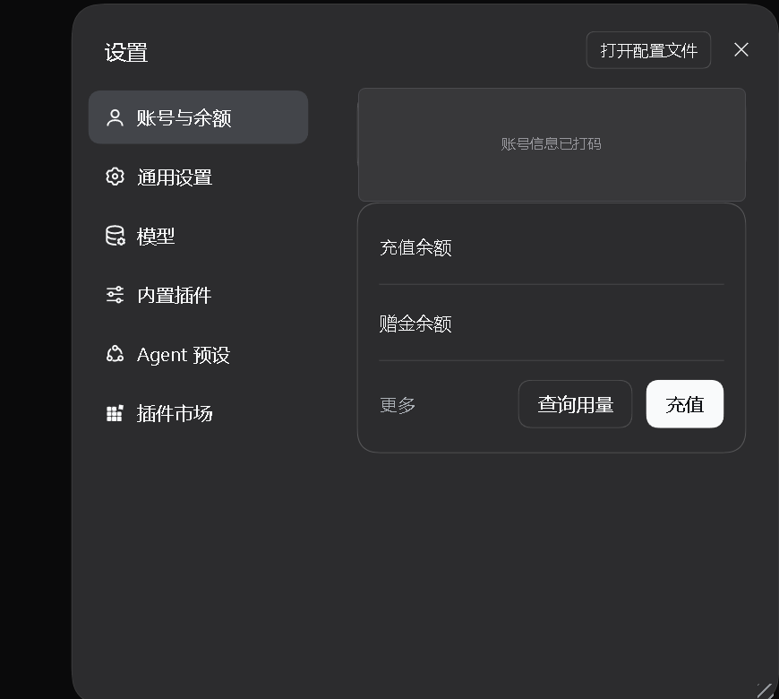

# dsh-settings-drag

让 DeepSeek Harness (DSH) Web 界面的**设置面板自由拖动 + 缩放**的小插件。

设置面板默认是固定 800×800、永远居中的弹窗。这个插件让它像普通窗口一样：可以拖到任意位置、拖边缘改大小，并且记住你的位置和尺寸。



## 效果

- **拖动**：按住左侧导航栏空白处或顶部标题条，把面板拉到窗口内任何位置。
  允许探出屏幕边缘（右/下/上可大幅探出），但始终保留可抓回的部分：
  左侧至少 160px（导航栏）、顶部至少 96px（标题带）、右/底边至少 96px 在屏内 —— 面板永远丢不了。
- **缩放**：三个抓手，和普通窗口一致 ——
  右下角三角握角（双轴）、右边缘上段（宽度）、底边缘中段（高度）。
  尺寸范围 480×360 ~ 视口-48px，左上角锚定不漂移。
- 按钮、输入框等交互元素上按下不受影响（照常点击）。
- **双击**导航/标题条 → 位置动画归中、尺寸恢复默认、记忆清空。
- 位置与尺寸记忆在浏览器 `localStorage`，重开面板、刷新页面不丢；窗口尺寸变化时自动重新约束。

## 安装

```sh
dsh plugin --profile desktop add dsh-settings-drag
```

然后重启桌面端（或 `dsh web` 服务）。刷新页面即生效。

## 兼容性

- 声明 `engines.dsh: >=0.2.0-rc.2 <0.3.0-0`（在 0.2.1-rc.2 上验证）。
- 插件不读取文件、不联网、不碰凭据 —— 纯前端 UI 调整，市场能力扫描应为空。
- 依赖设置面板的稳定结构属性 `data-shortcut-modal="settings"`；若未来 DSH 前端改动该结构，
  插件会静默退化为"不生效"，不会破坏应用。

## 实现

- 服务端半区（`lib/index.js`）：向 `webserver/index-inject` 推一行内联 `<script>` 注入
  （桌面端唯一可靠注入通道，吞掉 onerror 保证失败时不影响宿主启动），并注册
  `GET /dsh-settings-drag/settings-drag.js` 路由，按 mtime 缓存读取客户端脚本。
- 客户端半区（`assets/settings-drag.js`）：纯 DOM 脚本、无依赖。
  - 面板定位：`div[role=dialog][data-shortcut-modal="settings"]`（避开 CSS module 哈希类名）；
  - 抓取区：面板的 `<nav>` 直接子元素 + content 的第一个子元素；
  - 缩放抓手：三个独立 `position:fixed` 元素挂在 `body` 上，跟随面板边缘移动 ——
    不进入 React 管辖的容器，零冲突；面板关闭时自动隐藏。

## 卸载

```sh
dsh plugin --profile desktop remove dsh-settings-drag
```

浏览器侧残留的 localStorage 键可手动清（`dsh-settings-drag-offset-v1` / `dsh-settings-drag-size-v1`）。

## 边界

- 设置面板渲染在应用窗口网页里，无法浮出应用窗口到操作系统桌面上（那需要原生窗口改造）；
  窗口最大化时，面板即可在整个屏幕上移动。
- 拖动/缩放只作用于设置面板本体；背景遮罩始终盖满窗口。

## 开发

```sh
# 本机调试：改 assets/settings-drag.js 后硬刷新页面即可（路由按 mtime 重读），无需重启
npm pack --dry-run   # 检查发布内容
```

## License

MIT
